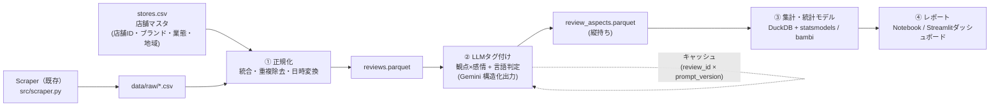

# 口コミ × 星評価 分析システム 提案書

## 0. 現状データの確認結果（赤から つくば研究学園店）

[reviews_store_2_20261006_061528.csv](file:///Users/hiranotakahiro/Projects/Googleマップレビュー分析/data/raw/reviews_store_2_20261006_061528.csv) を集計した結果です。

| 星 | 本文なし | 本文あり | 計 |
|---|---|---|---|
| ★1 | 6 | 11 | 17 |
| ★2 | 5 | 6 | 11 |
| ★3 | 24 | 11 | 35 |
| ★4 | 28 | 19 | 47 |
| ★5 | 27 | 17 | 44 |
| **計** | **90** | **64** | **154** |

分析設計に影響する事実：

- **本文があるのは64件（42%）だけ**です。観点別の分析に使えるのはこの64件で、★1〜2に限ると17件です。
- **本文ありの平均は★3.39、本文なしは★3.72**でした。不満がある人ほど文章を書く傾向（選択バイアス）が見えます。
- **日本語以外の口コミは0件**です。ただし、取得時のロケールのせいでGoogleが翻訳した文を返している可能性もあるので、原文と言語コードを取れているか確認が必要です（§5）。
- このCSVの `post_time` は「7 年前」のような相対表記です。現在の [parser.py](file:///Users/hiranotakahiro/Projects/Googleマップレビュー分析/src/parser.py#L136-L148) は絶対日時・`review_id`・オーナー返信を出力できるので、**再取得すれば時系列分析ができるようになります**。

> [!WARNING]
> 1店舗64件では、統計的な結論（どの観点が星に効くか）はほぼ出せません。単店舗の段階では「パイプライン構築と傾向の把握」にとどめ、寄与度の推定は**複数店舗のデータをまとめた上で**行う前提で設計します。

---

## 1. システム構成（推奨：まずローカルで小さく作り、後でクラウドへ移行）



| レイヤ | 技術 | 理由 |
|---|---|---|
| 保存 | Parquet + DuckDB | 数万件まではサーバー不要で、SQLで集計できる |
| LLM | Gemini Flash系（構造化出力 / JSON Schema） | 多言語に対応し、低コストで、出力の形式を固定できる |
| 統計 | statsmodels（順序ロジット）、bambi/PyMC（階層ベイズ） | 寄与度とその不確実性を出せる |
| 可視化 | Jupyter → Streamlit | 探索 → 共有用の画面へ段階的に作る |

**将来の拡張**：店舗数が増え、売上データ（POS）と結合する段階になったら、同じスキーマのまま **BigQuery** へ移せます。BigQueryでは `AI.GENERATE` などでSQLの中からLLMを呼べるので、タグ付けまで含めてDWH内で完結できます。

### ディレクトリ案

```
src/
  scraper.py, parser.py, ...    # 既存
  pipeline/
    normalize.py                # raw → reviews.parquet
    tag_aspects.py              # LLMタグ付け（キャッシュ付き）
    prompts/aspect_v1.md        # プロンプトはバージョン管理する
  analysis/
    descriptive.py              # 言及率・感情・低評価要因
    drivers.py                  # 寄与度モデル
data/
  master/stores.csv
  processed/reviews.parquet, review_aspects.parquet
  annotations/gold_sample.csv   # 人手の正解ラベル（検証用）
notebooks/
```

---

## 2. LLMによる観点別タグ付けの設計

### 観点（固定のタクソノミー）
| key | 観点 | 含む例 |
|---|---|---|
| taste | 味 | 美味しい、辛さ、量、メニューの豊富さ |
| service | 接客 | 態度、声かけ、オーダーミス |
| speed | 提供時間・待ち | 料理が出るまでの時間、入店待ち、呼び出しへの反応 |
| price | 価格 | 高い・安い、コスパ |
| atmosphere | 雰囲気 | 内装、騒がしさ、客層、席の広さ |
| cleanliness | 清潔さ | 店内、トイレ、食器 |
| other | その他 | 駐車場、立地、予約システムなど |

### 1件あたりの出力（JSON Schema で固定）
```json
{
  "language": "ja",
  "aspects": [
    {"aspect": "service", "sentiment": -2, "evidence": "店員にすごく乱暴に押し出され"},
    {"aspect": "speed",   "sentiment": -1, "evidence": "10分以上待ちましたが…案内も注文を取りに来る気配も"}
  ]
}
```
- `sentiment` は −2〜+2 の5段階です。言及のない観点は出力しません（＝未言及）。
- `evidence`（根拠になる原文の抜き出し）を必須にします。後から人が確認でき、LLMの判定の誤りも見つけやすくなります。

> [!IMPORTANT]
> **LLMには星の数を渡しません（ブラインド判定）。** 星を見せると、LLMが星に引きずられて感情スコアを付け、「観点が星に効いている」という結果が見かけ上作られてしまう（リーク）ためです。

### 品質の担保
1. 50件ほどを人手でラベル付けし、LLMとの一致度（観点ごとのF1、感情のκ係数）を測ります。
2. temperature=0で2回実行し、結果がぶれないか確認します。
3. 結果は `review_id × prompt_version` でキャッシュし、再実行しても課金されないようにします。

---

## 3. 4つの分析の方法

### 3-1. 観点別の分解
- **言及率** ＝ その観点に触れた口コミ数 ÷ 本文ありの口コミ数
- **観点の評価** ＝ 平均感情スコア、またはネット感情（肯定の割合 − 否定の割合）
- 縦軸を言及率、横軸を平均感情にした散布図にすると、「よく話題になり、評価も悪い」観点がひと目で分かります。

### 3-2. 低評価の要因
- ★1〜2の口コミで**否定的に言及された観点**の頻度順位を出します。
- 頻度に加えて **Lift ＝ P(否定言及 | ★1〜2) ÷ P(否定言及 | 全体)** も出し、低評価に特有の要因を浮かび上がらせます（どの星でも言われる不満と区別するため）。
- 根拠の文を観点ごとに並べ、現場で取るべき打ち手のリストにします。

### 3-3. インバウンドの把握
- 言語の構成比と、言語別の平均星・観点別の感情を出します。
- 前提として、§5の原文と言語コードの取得を確認する必要があります。今回の店舗は日本語のみなので、観光地の店舗が加わってから意味が出てくる分析です。

### 3-4. 店舗間・業態間の比較
- 店舗（または業態）× 観点 のヒートマップ（言及率・感情）を作ります。
- 件数の少ない店舗の値が極端にぶれないよう、**階層ベイズで縮小推定（部分プーリング）**します。

---

## 4. 最終目標：「どの観点が星の数に寄与しているか」

### 主モデル：順序ロジスティック回帰（階層ベイズ版）

```
rating(1〜5, 順序) ~ Σ_aspect [ β⁺·pos_aspect + β⁻·neg_aspect ]
                    + 文字数 + ローカルガイドか + 投稿年
                    + (1 | store) + (1 | genre)
```

- **肯定と否定を別々の変数にします**（未言及が基準）。これで「接客は悪いと大きく減点されるが、良くても加点は小さい」といった**非対称性**（Penalty-Reward分析／狩野モデルの当たり前品質・魅力品質）が分かります。
- 星は1〜5の順序カテゴリなので、平均を取る線形回帰より順序ロジットが適しています。
- 店舗と業態を変量効果に入れ、「店舗ごとの星の付きやすさの違い」と「観点の効果」を分けて推定します。

### 補助的な分析（結論の頑健性を確かめるため）
| 手法 | 目的 |
|---|---|
| 相対重要度（Dominance分析 / Shapley値によるR²の分解） | 観点同士の相関があっても、寄与度をシェアとして示す |
| 勾配ブースティング + SHAP | 非線形の関係や交互作用（例：味が良ければ価格の不満が帳消しになる）を見る |
| LLMを使わないベースライン（TF-IDF + Ridge回帰で星を予測） | LLMの観点分類が見落としている語句がないかを確かめる |

### 解釈するときの注意点
- **選択バイアス**：本文のない90件は観点を推定できません。「本文を書く人」についての結論だと明記します（本文の有無をモデルに入れる・感度分析をする、などで対処します）。
- **言及バイアス**：書かれていない＝問題がない、とは限りません。
- **因果ではありません**：口コミと星の相関構造です。因果に近づけるには、後で売上データや施策の前後比較を組み合わせます。

---

## 5. 事前に確認・対応したいこと

1. **再スクレイピング**：現在のparserで再取得し、`review_id`・絶対日時・オーナー返信を取ります（オーナー返信の有無も分析に使えます）。
2. **原文と言語コード**：Googleが翻訳文を返していないか、APIの応答に原文と言語コードが含まれているかを、`data/debug/` の生JSONで確認します。
3. **店舗マスタ**：`store_id, brand, genre, area, url` の `stores.csv` を作ります。

## 6. 進め方（案）

| フェーズ | 内容 | 成果物 |
|---|---|---|
| 1 | 正規化パイプラインと店舗マスタ | reviews.parquet |
| 2 | LLMタグ付けと人手での検証（50件） | review_aspects.parquet、精度レポート |
| 3 | 記述統計（3-1〜3-3） | Notebook |
| 4 | 店舗追加後に寄与度モデル（§4）と店舗比較（3-4） | ドライバー分析レポート |
| 5 | Streamlitダッシュボード／売上データとの結合 | ダッシュボード |
