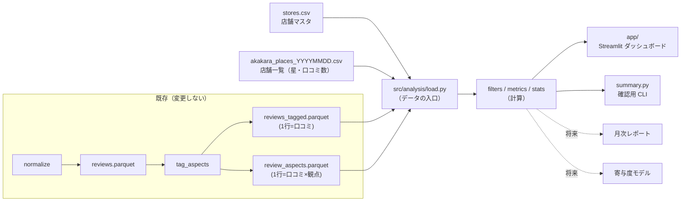

# 口コミ分析ツール 設計書（v1.0）

- 版: v1.0（2026-10-31）
- 実装はこの文書と [02_execution_plan.md](02_execution_plan.md) に従う
- 元の提案: [../analysis_proposal.md](../analysis_proposal.md)。§3 の分析方法、§4 の寄与度モデル、§6 のフェーズ 3〜5 を、この計画で具体化する
- 収集側の計画: [../api_collector/03_execution_plan.md](../api_collector/03_execution_plan.md)。店舗のデータが増える時期は、こちらの進捗で決まる
- 「**要確認**」と書いた項目は、§9 の未決事項で決める

---

## 1. 目的とスコープ

**目的**: 集めた口コミを「店舗 × 観点 × 時期」で見られるようにする。低評価の原因や店舗ごとの強み・弱みを、根拠の原文と一緒に確かめられるツールを作る。店舗が 1 店から 100 店以上に増えても、収集が定期化して期間が延びても、作り直さずに使えることを重視する。

**やること**
- 分析の計算部分（`src/analysis/`）: 指標・信頼区間・絞り込みを関数にまとめる
- ダッシュボード（`app/`、Streamlit）: 6 画面（§6）
- 確認用の CLI（`python -m src.analysis.summary`）: 主な表を端末に出す

**やらないこと（この計画の範囲外）**
- 収集（`api_collector` の計画で行う）
- タグ付けのプロンプトや観点の定義の変更（`src/pipeline/` は変更しない。必要になったら手を止めて確認する）
- 売上データ（POS）との結合（提案書 §6 のフェーズ 5。データが手に入ってから別の計画にする）

### 1.1 現状のデータ（2026-10-31 時点）

| データ | 状態 | 分析への影響 |
|---|---|---|
| `reviews.parquet` | 159 件（store_2 が 154 件、store_1 が 5 件）。本文ありは 69 件 | 1 店舗分なので、店舗比較と寄与度はまだ出せない |
| 投稿日時 | 159 件すべてが相対表記（「7 年前」など）からの推定（`time_is_estimated`） | 月単位の推移は出せない。年単位まで |
| オーナー返信 | 0 件（旧形式の取得では取れていない） | 返信率は新しいデータから |
| タグ付け結果（`reviews_tagged.parquet`） | **未作成**（タグ付けを実行していない） | 観点の画面（②③④）はタグ付けの後 |
| 人手ラベル（`gold_sample.csv`） | 50 件を抽出済み。**未記入** | タグの精度を確かめていない |
| 赤からの店舗一覧（`data/master/akakara_places_20261031.csv`） | 110 店舗・33 都道府県の星・口コミ数・市区町村・place_id。緯度経度はない | 画面①は今すぐ作れる |
| 店舗マスタ（`stores.csv`） | 13 店舗。店舗一覧と対応するのは 11 店舗（place_id で 8、店名で 3）。store_1（店名不明）と store_3（柏西口店）は一覧にない | 一覧は赤からの全店舗ではない可能性がある |

---

## 2. 基本方針

1. **計算と画面を分ける。** 指標の計算は `src/analysis/` の関数（DataFrame を受け取り DataFrame を返す）にまとめる。画面は表示と操作だけを受け持つ。同じ関数を、ダッシュボード・CLI・ノートブック・将来の月次レポートで使い回す
2. **データの入口を 1 か所にする。** ファイルの読み込みは `src/analysis/load.py` だけが行う。データが増えて DuckDB や BigQuery に移すときは、ここを差し替えれば済むようにする
3. **件数を必ず添える。** すべての指標に件数（n）と 95% 信頼区間を付け、件数が少ないものは「参考値」と表示する（§5.3）
4. **既存のパイプラインは読むだけにする。** `src/pipeline/` の出力ファイルと、`paths.py` の定義（`ASPECTS`、`PROCESSED_DIR` など）を import して使う。変更はしない
5. **個人を特定する情報を画面に出さない。** 投稿者名・投稿者 ID は読み込まない（分析に使わない）。本文と根拠の文は表示する
6. **架空データで動かせるようにする。** データの場所を環境変数で切り替えられるようにし、テストと画面の確認（スクリーンショットを含む）は架空データで行う

---

## 3. 全体構成



### 3.1 ファイル構成

```
src/analysis/
  __init__.py
  load.py        # 読み込み・型の統一・店舗キーの付与（データの唯一の入口）
  filters.py     # 店舗・期間・星・言語・本文の有無での絞り込み
  metrics.py     # 指標（星の分布、観点の言及率・感情、低評価の要因、返信率）
  stats.py       # 信頼区間・参考値の判定（Phase 3 で縮小推定を追加）
  summary.py     # 確認用 CLI: python -m src.analysis.summary [--store store_2]
app/
  dashboard.py   # 入口。st.navigation でページを切り替え、共通の絞り込みをサイドバーに置く
  views/
    overview.py    # ① 全店舗一覧
    aspects.py     # ② 観点マップ
    low_rating.py  # ③ 低評価の要因
    search.py      # ④ 口コミ検索
    compare.py     # ⑤ 店舗比較（Phase 3）
    trend.py       # ⑥ 推移（Phase 4）
.streamlit/config.toml     # localhost だけで待ち受け、利用統計を送らない（§7）
requirements-analysis.txt  # -r requirements.txt に、分析ツールの依存を足したもの
tests/analysis/
  fixtures/      # 架空の口コミ・観点・店舗一覧（CSV。テストの中で parquet に変換する）
  conftest.py    # 架空データを一時フォルダに置き、環境変数をそこへ向ける
  test_load.py, test_metrics.py, test_stats.py, test_app.py
```

- 起動: プロジェクト直下で `python -m streamlit run app/dashboard.py`。`-m` を付けて起動すると、プロジェクト直下が import の対象になり、`src.analysis` を読める
- データの場所: 環境変数 `ANALYSIS_DATA_DIR`（既定は `paths.PROCESSED_DIR`）と `ANALYSIS_MASTER_DIR`（既定は `data/master/`）。テストと架空データでの確認では、ここを架空データに向ける
- ページのファイルは `views/` に置く（Streamlit は `pages/` という名前のフォルダを特別扱いするため、避ける）

---

## 4. 入力データ

`load.py` が読むファイルと列。ここに書いた列だけに依存する（列が増えても壊れない）。

### 4.1 口コミ（`reviews_tagged.parquet`、1 行 = 口コミ）

`tag_aspects` の出力。`reviews.parquet` の全列の横に、タグ付けの結果が付いたもの。

| 列 | 用途 |
|---|---|
| `review_uid`, `store_id`, `store_name`, `brand`, `genre`, `area` | 識別・絞り込み |
| `rating` | 星（1〜5） |
| `review_text`, `has_text`, `text_len` | 本文・本文の有無 |
| `post_time`, `time_is_estimated`, `post_year` | 時期。推定の日時は年単位でだけ使う（§5.4） |
| `is_local_guide`, `reviewer_review_count` | 投稿者の属性（寄与度モデルで統制に使う） |
| `has_owner_reply`, `owner_reply_time` | 返信率・返信までの日数 |
| `llm_tagged`, `language`, `overall_sentiment` | タグ付け済みか・言語・総合的な感情 |
| `<観点>_mentioned`, `<観点>_sent`, `<観点>_pos`, `<観点>_neg` | 観点ごとの言及と感情。観点は `paths.ASPECTS` の 7 つ |

- タグ付けの前でも画面①と星の集計を使えるように、`reviews_tagged.parquet` がなければ `reviews.parquet` を読み、観点の列は空として扱う
- `reviewer_name`, `reviewer_id`, `reviewer_attributes` は読み込まない（§2 の 5）
- 店舗マスタの `store_key`（`store_N`）を `store_id` で結び付けて足す。CLI と画面では `store_key` で店舗を指定する

### 4.2 観点の詳細（`review_aspects.parquet`、1 行 = 口コミ × 観点）

`aspect`, `aspect_label`, `sentiment`, `subtopic`, `evidence`, `evidence_verbatim` を使う。根拠の文の表示（③④）と、具体的な対象の集計（例: 「呼び出しボタン」への不満が何件あるか）に使う。`evidence_verbatim` が False の根拠（本文の中に見つからない）は、画面で印を付ける。

### 4.3 店舗

- 店舗マスタ `stores.csv`: `store_key`, `store_id`, `store_name`, `brand`, `genre`, `area`, `place_id`
- 店舗一覧 `akakara_places_YYYYMMDD.csv`: `store_name`, `rating`, `reviews_count`, `prefecture`, `city`, `placeId`。ファイル名の日付を `snapshot_date` として読む。**同じ名前の付け方で取り直したファイルが増えれば、店舗ごとの星の推移になる**（§8）
- 結び付け: 店舗一覧の `placeId` と店舗マスタの `place_id` で結ぶ。`place_id` が空の店舗は、店名が完全に一致する場合だけ結ぶ。どちらでも結べない店舗（現在は store_1 と store_3）は、画面①で「一覧にない店舗」として別に表示する
- 口コミと店舗マスタは `store_id` で結ぶ
- 店舗一覧に緯度経度はない。地図を表示したい場合は、Apify の店舗検索の元データ（`data/raw_vendor/apify/`）から足せる見込み（**要確認**。追加の課金はない）

---

## 5. 計算の定義（`metrics.py`, `stats.py`）

### 5.1 指標

観点の指標の分母は「タグ付け済みで本文がある口コミ」（`llm_tagged & has_text`）。本文のない口コミは、観点の指標に入れない。

| 指標 | 定義 | 使う画面 |
|---|---|---|
| 平均星・星の分布 | 収集した口コミの `rating` の平均と構成比。店舗一覧にある Google の公表値と並べて表示する | ①⑤ |
| 本文あり率 | 本文がある口コミ ÷ 全口コミ | ①⑤ |
| 言及率 | その観点に触れた口コミ ÷ 分母 | ②⑤ |
| 平均感情 | 言及した口コミの `sentiment`（-2〜+2）の平均 | ②⑤⑥ |
| ネット感情 | （肯定の言及 − 否定の言及）÷ 言及数 | ②⑤ |
| 否定率 | 否定的に言及した口コミ ÷ 分母 | ③⑥ |
| 低評価 Lift | P(否定言及 \| ★1〜2) ÷ P(否定言及 \| 全体)。1 より大きいほど、低評価に特有の不満 | ③ |
| 返信率・返信までの日数 | オーナー返信がある口コミの割合（全体と ★1〜2 で別々に）、`owner_reply_time − post_time` の中央値 | ⑤（新しいデータから） |
| 言語の構成 | `language` の構成比と、言語別の平均星 | ①②（インバウンドの把握） |

### 5.2 関数の形（案）

```python
from __future__ import annotations

def aspect_summary(df: pd.DataFrame, by: list[str] | None = None) -> pd.DataFrame:
    """観点ごとの n・言及数・言及率・平均感情・ネット感情・否定率と、それぞれの信頼区間を返す。
    by に ["store_key"] などを渡すと、その単位で集計する。"""

def low_rating_drivers(df: pd.DataFrame, low: tuple[int, ...] = (1, 2)) -> pd.DataFrame:
    """観点ごとの否定言及の件数（★1〜2・全体）と、Lift とその信頼区間を返す。"""

def top_subtopics(aspects: pd.DataFrame, aspect: str, sentiment: str = "neg", k: int = 10) -> pd.DataFrame:
    """ある観点の中で、よく言及される具体的な対象（subtopic）を件数順に返す。"""
```

- 関数には `filters.apply(df, stores=..., period=..., ratings=..., languages=...)` で絞り込んだ DataFrame を渡す。関数の中では絞り込まない
- Python 3.9 のため、`X | None` を使うファイルには `from __future__ import annotations` を書く。`match` 文は使わない

### 5.3 件数が少ないときの扱い

- 割合（言及率・否定率・本文あり率・返信率）: Wilson の 95% 信頼区間
- 平均（平均感情・平均星）と Lift: ブートストラップ（1,000 回、乱数の種を固定）の 95% 区間。Lift は否定言及が 0 件のときは計算しない
- 分母が `MIN_N`（既定 20）未満の値は「参考値」として淡い色で表示し、並べ替えたときに上位に出さない。`MIN_N` は `stats.py` の定数にする
- Phase 3 で、店舗ごとの割合を全店舗の平均に寄せる縮小推定（ベータ二項分布による経験ベイズ）を足す。関数の戻り値に列を足すだけにして、画面を作り直さずに済むようにする

### 5.4 時期の扱い

- `time_is_estimated` が True の口コミ（相対表記から推定した日時）は、**年単位**でだけ使う。月単位の集計からは外し、外した件数を画面に出す
- 現在のデータ（159 件）はすべて推定の日時なので、月単位の推移（⑥）は外部サービスで取った新しいデータから使える

---

## 6. 画面

**共通**: サイドバーに絞り込み（ブランド・店舗・期間・星・言語）を置き、全画面で共有する。絞り込みの内容は URL のクエリに残し、同じ表示を再現できるようにする（口コミの中身は URL に入れない）。各グラフの下に「n = 件数」と参考値の注記を出す。画面の隅に、観点の定義の版（`paths.PROMPT_VERSION`）とデータファイルの更新日時を出す。

| # | 画面 | 見せるもの | 必要なデータ | 使える時期 |
|---|---|---|---|---|
| ① | 全店舗一覧 | 都道府県別の店舗数と平均星の表。散布図（横: 口コミ数、縦: 星）で、目立って低い店・高い店を探す。収集済みの店舗に印を付ける。店舗を選ぶと⑤へ移る | 店舗一覧、店舗マスタ | **Phase 2（今すぐ作れる）** |
| ② | 観点マップ | 散布図（横: 平均感情、縦: 言及率、点: 観点、点の大きさ: 言及数）。左上が「よく話題になり、評価が低い」観点。観点を選ぶと、よく出る具体的な対象（subtopic）を表示する | タグ付け結果 | Phase 2 |
| ③ | 低評価の要因 | ★1〜2 での否定言及の件数と Lift の棒グラフ（信頼区間つき）。観点を選ぶと、根拠の原文を一覧で表示する | タグ付け結果 | Phase 2 |
| ④ | 口コミ検索 | 観点・感情・星・店舗・キーワードで絞り込んだ口コミの一覧。本文の横に観点のタグと根拠を表示する。CSV で書き出せる | タグ付け結果 | Phase 2 |
| ⑤ | 店舗比較 | 店舗 × 観点のヒートマップ（言及率とネット感情を切り替え）。縮小推定の値と元の値を切り替える。店舗ごとの返信率 | 複数店舗のタグ付け結果 | Phase 3 |
| ⑥ | 推移 | 月別の件数・平均星・観点ごとの否定率の折れ線。日付を指定して前後を比べる（施策の効果の目安）。店舗一覧のスナップショットが 2 つ以上あれば、Google の星の推移も出す | 実日時のデータ | Phase 4 |

- グラフは Plotly を使う。点を選んで詳細を出す操作にも使う
- 地図は、緯度経度を足せた場合だけ①に加える（§4.3）

---

## 7. 個人情報と公開範囲

- **ローカルだけで使う**（D1 の既定）: `.streamlit/config.toml` に `server.address = "localhost"` を書き、同じネットワークにある他の端末から開けないようにする。`browser.gatherUsageStats = false` で、Streamlit の利用統計の送信を止める
- 投稿者名・投稿者 ID は読み込まない。本文と根拠の文は表示する
- ④の CSV 書き出しと画面のスクリーンショットには口コミの本文が入るので、コミットしない。書き出し先は `data/processed/exports/`（すでに `.gitignore` の対象）
- `.streamlit/secrets.toml` を作る場合に備えて、`.gitignore` に足す
- 他の人に見せる段階（Phase 6）では、架空データで画面を見せるか、公開範囲と認証を改めて決める

---

## 8. 規模が大きくなったときの備え

| 変化 | 備え |
|---|---|
| 店舗が 100 店以上、口コミが数万件 | 数万行なら pandas のままで足りる見込み。遅くなったら `load.py` の中身を DuckDB に差し替える。画面のデータ読み込みは `st.cache_data` でキャッシュする（ファイルの更新日時をキーにする） |
| 収集の定期化 | タグ付けは、キャッシュ済みの口コミに再び課金しない（既存の仕組み）。ダッシュボードはファイルを読み直すだけ。店舗一覧も同じ名前の付け方で保存すれば、星の推移になる |
| ブランド・業態が増える | `brand`・`genre` を、最初から絞り込みと比較の単位に入れておく |
| 観点の定義を変える（`aspect_v2`） | 観点の一覧は `paths.ASPECTS` から読み、画面に観点名を直接書かない。どの版の結果かはファイルに記録されていないので、画面に現在の `PROMPT_VERSION` とファイルの更新日時を出す |
| 寄与度モデル（提案書 §4） | Phase 5 で `src/analysis/drivers.py` を足し、画面を 1 つ加える。それまでの画面は変えない |
| 他の人との共有、BigQuery への移行 | 計算の関数はそのまま使い、`load.py` の読み込み先と画面の置き場所だけを変える（Phase 6） |

---

## 9. 未決事項

| ID | 決めること | 推奨（既定） | 決める時期 |
|---|---|---|---|
| D1 | 誰が使うか | 自分だけ（ローカル）。共有するなら Phase 6 で公開方法と認証を決める | Phase 2 の前（既定のまま進めてよい） |
| D2 | 目的の重心（店舗の改善に使う／星に効く観点を調べる） | 両方。1 店舗でも役に立つ改善向けの画面（②③④）を先に作る。調査向けの寄与度は、店舗が揃う Phase 5 で行う | Phase 2 の前（既定のまま進めてよい） |
| D3 | Python の版 | 下の表のとおり **案 A** | Phase 1 の前。Phase 5 の前に見直す |
| D4 | タグの精度の合格基準 | 主な 4 観点（味・接客・提供時間・価格）で、検出の F1 が 0.8 以上、感情の ±1 一致率が 0.9 以上。gold に 5 件未満しか出てこない観点は判定から外し、件数を書き添える。基準を満たさない観点は、画面で「精度未確認」と表示する | Phase 0 |
| D5 | 「参考値」にする件数 `MIN_N` | 20 | Phase 1（画面を見て調整） |

### 9.1 D3: Python の版

2026-10-31 に PyPI で確認した結果、主なライブラリの最新版は Python 3.9 を対象から外している。

| ライブラリ | 最新版（必要な Python） | Python 3.9 で使える最後の版 |
|---|---|---|
| streamlit | 1.66.1（3.11 以上） | 1.50.0（2025-09） |
| statsmodels | 0.15.0（3.10 以上） | 0.14.6（2025-12） |
| pymc | 6.3.2（3.12 以上） | 5.12.0（2024-03） |
| plotly | 7.1.0（3.8 以上） | 7.1.0（最新版のまま使える） |
| pytest | 9.2.0（3.10 以上） | 8.4.2（2025-09） |

| 案 | 内容 | 長所 | 短所 |
|---|---|---|---|
| **A（推奨）** | Python 3.9 のまま、上の「3.9 で使える最後の版」に固定する | 追加の作業がない。既存の `.venv` 1 つで済む | 更新を受けられない（Streamlit は 2025-09 の版）。Phase 5 の階層ベイズが古い PyMC になる |
| B | 分析ツールだけ別の環境（`.venv-analysis`、Python 3.12）で動かす | 新しい版を使える。収集側に影響しない | 環境が 2 つになり、コマンドごとに使い分けが必要 |
| C | プロジェクト全体を Python 3.12 に上げる | 環境が 1 つで済む。Python 3.9 はサポートが終了している（2025-10） | 収集（Playwright）とパイプラインの動作確認をやり直す必要があり、この計画の範囲を超える |

- 推奨の理由: ローカルだけで使うなら古い版でも実害は小さく、すぐに始められる。`src/analysis/` は 3.9 の書き方で作るので、後で B や C に移ってもそのまま動く
- Phase 5 の前に、C を別の計画として検討する
- Homebrew の Python 3.11 は導入済み。3.12 を使う場合は `brew install python@3.12` が必要

---

## 10. テスト方針

- `tests/analysis/fixtures/` に、架空の口コミ（20 件程度）と架空の店舗一覧（5 店舗程度）を置く。口コミは 2 店舗分で、★1〜5、本文なし、推定日時と実日時、オーナー返信あり、英語の口コミを含める。**実データからは作らない**（投稿者名・本文はすべて創作）
- `test_metrics.py`: 手で計算した値と一致すること（言及率・平均感情・Lift・Wilson 区間）。分母が 0 や 1 のときに例外にならないこと
- `test_load.py`: `reviews_tagged.parquet` がなくても `reviews.parquet` で動くこと。投稿者名の列が読み込まれないこと。店舗一覧と店舗マスタの結び付け（place_id → 店名 → 結べない）
- `test_app.py`: `streamlit.testing.v1.AppTest` で、全画面を架空データで開いて例外が出ないこと
- 実データでの確認は、`python -m src.analysis.summary` の出力（件数と主な表）で行う
