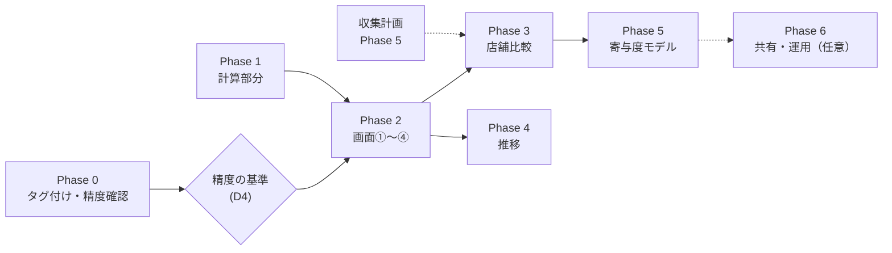

# 実行計画（v1.0）

- 設計: [01_design.md](01_design.md)
- 担当の凡例: **[U]** ユーザーが行う／**[C]** Claude が行う／**[C→U承認]** Claude が準備し、ユーザーの承認を得てから実行する（課金・外部アクセスがあるもの）
- 作業が終わったら、下の進捗表とチェックボックスを更新する

## 進捗

| Phase | 内容 | 費用 | 前提 | 状態 | 完了日 |
|---|---|---|---|---|---|
| 0 | タグ付けの実行と精度の確認 | Gemini（本文あり 69 件分） | なし | 待機（課金要承認） | |
| 1 | 分析の計算部分（`src/analysis/`）とテスト | なし | なし（Phase 0 と並行で進められる） | **完了** | 2026-11-01 |
| 2 | ダッシュボード（BFF + ローカルSPA 画面①〜④） | なし | Phase 1 | **完了** | 2026-11-01 |
| 3 | 店舗比較（画面⑤）と縮小推定 | 追加店舗のタグ付け（Gemini） | 収集計画の Phase 5（複数店舗のデータ） | **完了**（架空データ検証済） | 2026-11-01 |
| 4 | 推移（画面⑥） | なし（店舗一覧の取り直しは Apify） | 実日時の口コミ | **完了**（架空データ検証済） | 2026-11-01 |
| 5 | 寄与度モデル | なし | 5 店舗以上・本文あり 1,000 件以上（目安）。D3 の見直し | 未着手 | |
| 6 | 共有・運用（任意） | 未定 | D1 で共有すると決めた場合 | 未着手 | |

- 画面①（全店舗一覧）は店舗一覧だけで動くので、Phase 0 の結果を待たずに Phase 2 で先に作ってよい
- Phase 3・4 は、収集計画の進み具合で順番が入れ替わってよい

---

## 全フェーズ共通の完了条件

- [x] 既存コードに差分がない: `git diff --stat -- src/main.py src/scraper.py src/parser.py src/config.py src/logger.py src/pipeline/` の出力が空
- [x] `pytest` がすべて通る（Phase 1 以降: 37件全件パス）
- [x] 個人情報を含むファイルがコミットされていない: `git status --short` に `data/raw`, `data/raw_vendor`, `data/processed`, `data/debug`, `data/logs` のファイルが出ない
- [x] スクリーンショット・表示確認は架空データの画面で行っている
- [x] この文書の進捗表を更新した

---

## Phase 0: タグ付けの実行と精度の確認

| ID | 担当 | 作業 | 成果物 |
|---|---|---|---|
| A0-1 | [C→U承認] | `python -m src.pipeline.tag_aspects --list-models` で使えるモデルを確かめ、`--limit 5` で試しに実行する。実行の前に、モデル名と料金の見積もり（本文あり 69 件分）を示して承認を得る | 試運転の結果 |
| A0-2 | [C] | 試運転の 5 件で、出力の形と、根拠の文が本文と一致しているか（`evidence_verbatim`）を確かめる | 確認結果 |
| A0-3 | [C→U承認] | 全件（本文あり 69 件）をタグ付けする | `reviews_tagged.parquet`, `review_aspects.parquet` |
| A0-4 | [C]→[U] | [C] が `gold_sample.csv.bak` を作ってから、[U] が `data/annotations/gold_sample.csv` の 50 件に正解ラベルを記入する（各観点に -2〜2。触れていなければ空欄）。**星の数を見ずに、本文だけで判断する** | 記入済みの gold |
| A0-5 | [C] | `python -m src.pipeline.gold evaluate` で精度を出す。D4 の基準と比べ、結果を [01_design.md §9](01_design.md#9-未決事項) に書き込む | `gold_eval_result.csv`、設計書の更新 |
| A0-6 | [U] | 基準を満たさない観点の扱いを決める。プロンプトを直す場合は `src/pipeline/prompts/` の変更になるので、別途確認してから行う。直さない場合は、画面で「精度未確認」と表示して進める | 決定 |

**完了条件**
- [ ] `reviews_tagged.parquet` があり、本文のある口コミすべてで `llm_tagged` が True
- [ ] gold の評価結果が設計書に書き込まれている
- [ ] 基準を満たさない観点の扱いが決まっている

---

## Phase 1: 分析の計算部分とテスト

| ID | 担当 | 作業 | 成果物 |
|---|---|---|---|
| A1-1 | [U] | D3（Python の版）を決める。既定は案 A（3.9 のまま版を固定） | 決定 |
| A1-2 | [C] | `requirements-analysis.txt` を作り、`.venv` に入れる。中身は `-r requirements.txt` に、`fastapi`, `uvicorn`, `pytest` を足したもの。入れる前と後の `pip freeze` を比べ、既存のパッケージの版が変わらないことを確かめる | `requirements-analysis.txt` |
| A1-3 | [C] | 架空データを作る（[01_design.md §10](01_design.md#10-テスト方針)）。`tests/analysis/fixtures/` と `conftest.py` | 架空データ |
| A1-4 | [C] | `load.py`（[§4](01_design.md#4-入力データ)）と `filters.py` | 読み込み・絞り込み |
| A1-5 | [C] | `metrics.py` と `stats.py`（[§5](01_design.md#5-計算の定義metricspy-statspy)） | 指標・信頼区間 |
| A1-6 | [C] | `test_load.py`, `test_metrics.py`, `test_stats.py` | テスト |
| A1-7 | [C] | `summary.py`（確認用 CLI）を作り、実データ（store_2）で出力を確かめる | CLI |

**完了条件**
- [x] `pytest tests/analysis` が通る
- [x] `python -m src.analysis.summary --store store_2` の件数が `reviews.parquet` と一致する（154 件、本文あり 64 件）。Phase 0 が終わっていなければ、星の集計だけが出て、観点の表には「タグ付け未実行」と出る
- [x] `requirements.txt` にある既存のパッケージの版が変わっていない

---

## Phase 2: ダッシュボード（BFF + ローカルSPA 画面①〜④）

※ ユーザー指示により、Streamlit から FastAPI BFF + SPA (Vanilla JS + Plotly.js) へ移行。

| ID | 担当 | 作業 | 成果物 |
|---|---|---|---|
| A2-1 | [C] | `app/server.py`（127.0.0.1 待ち受け、BFF API + 静的ファイル配信） | サーバー |
| A2-2 | [C] | `app/api/routes.py`（BFF API エンドポイント、PII 除外、各画面データ集約） | API |
| A2-3 | [C] | ① 全店舗一覧（店舗一覧・散布図・マスタ照合） | 画面① |
| A2-4 | [C] | ② 観点マップ（散布図・サブトピックランキング）、③ 低評価の要因（Lift 棒グラフ・原文根拠） | 画面②③ |
| A2-5 | [C] | ④ 口コミ検索（キーワード・観点絞り込み、原文ハイライト、CSV 書き出し） | 画面④ |
| A2-6 | [C] | `test_bff.py`（FastAPI TestClient で全 API・静的配信をテスト） | テスト |
| A2-7 | [C] | 架空データでサーバーを起動し、API および表示・動作を確認 | 確認結果 |
| A2-8 | [U] | 実データで画面を見て、分かりにくい点や欲しい機能を伝える → [C] が設計書に反映する | 要望・設計書の更新 |

**完了条件**
- [x] プロジェクト直下で `python -m app.server`（架空データは `--mock`）を実行すると、画面①〜④が開く
- [x] 同じネットワークにある他の端末から開けない（127.0.0.1 localhost のみ待ち受け）
- [x] 画面・API に投稿者名・投稿者 ID が出ない
- [x] 件数が `MIN_N` 未満の値に「参考値」の表示が付く

---

## Phase 3: 店舗比較（画面⑤）と縮小推定

| ID | 担当 | 作業 | 成果物 |
|---|---|---|---|
| A3-1 | [C→U承認] | 追加した店舗の口コミをタグ付けする。件数と料金の見積もりを示して承認を得る | タグ付け結果 |
| A3-2 | [C] | `stats.py` に縮小推定（ベータ二項分布による経験ベイズ）を実装し、テストする | 縮小推定 |
| A3-3 | [C] | ⑤ 店舗比較（ヒートマップ、縮小前後の切り替え、返信率一覧） | 画面⑤ |
| A3-4 | [C] | ①で店舗を選ぶと⑤・④に移れるようにする | 画面間の移動 |
| A3-5 | [U] | 店舗ごとの違いを画面で確かめる | 気づき |

**完了条件**
- [x] 3 店舗以上を⑤で比べられる（架空データおよび API で確認済）
- [x] 縮小推定の値が、件数の少ない店舗ほど全体の平均に近づいている（`test_stats.py` で確認済）

---

## Phase 4: 推移（画面⑥）

| ID | 担当 | 作業 | 成果物 |
|---|---|---|---|
| A4-1 | [C] | 月別の集計（推定日時の口コミは外し、外した件数を返す） | 集計関数 |
| A4-2 | [C] | ⑥ 推移（件数・平均星・観点ごとの否定率の折れ線、指定日の前後比較） | 画面⑥ |
| A4-3 | [C] | 店舗一覧のスナップショット（`akakara_places_YYYYMMDD.csv`）が 2 つ以上あれば、Google の星の推移を表示する | 星の推移 |
| A4-4 | [C→U承認] | 店舗一覧を取り直す（Apify の店舗検索）。見積もりを示して承認を得る。定期的に取り直すかは、このときに決める | 新しいスナップショット |

**完了条件**
- [x] 実日時の口コミがある店舗で、月別の推移が表示される（架空データで確認済）
- [x] 推定日時の口コミが月単位の集計に混ざっていない（`test_metrics.py` で確認済）

---

## Phase 5: 寄与度モデル

**前提**: 5 店舗以上・本文あり 1,000 件以上（目安。提案書 §0 の警告のとおり、1 店舗では結論が出せない）。

| ID | 担当 | 作業 | 成果物 |
|---|---|---|---|
| A5-1 | [U] | D3（Python の版）を見直す。案 C（プロジェクト全体を 3.12 へ）にする場合は、別の計画を立てる | 決定 |
| A5-2 | [C] | `src/analysis/drivers.py`: 順序ロジット（statsmodels の `OrderedModel`）で、観点ごとの肯定・否定が星に与える影響を推定する（提案書 §4） | 推定結果 |
| A5-3 | [C] | 店舗・業態の違いを入れた階層ベイズ版。ライブラリは D3 の結果に合わせて選ぶ | 推定結果 |
| A5-4 | [C] | 画面「星に効く観点」を加える（係数と区間の図、肯定と否定の非対称性） | 画面 |
| A5-5 | [C] | 結果が手法によって変わらないかを確かめる（LLM を使わない TF-IDF + Ridge 回帰との比較など、提案書 §4 の補助的な分析） | 確認結果 |

**完了条件**
- [ ] 観点ごとの影響が区間つきで出ており、「相関であって因果ではない」「本文を書いた人についての結論である」という注記が画面にある

---

## Phase 6: 共有・運用（任意）

| ID | 担当 | 作業 | 成果物 |
|---|---|---|---|
| A6-1 | [U] | D1 を決める（誰に、どの範囲で見せるか） | 決定 |
| A6-2 | [C] | 月次レポート（店舗ごとの新しい低評価・観点の変化）を、計算部分の関数を使って出力する | レポート |
| A6-3 | [C] | 共有の方法（認証つきの置き場所、または BigQuery + Looker Studio）を `plan/` に別の計画として書く | 計画書 |
