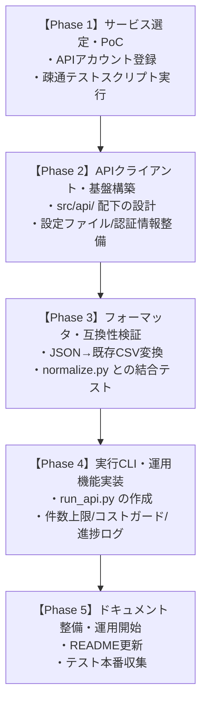

> [!CAUTION]
> **凍結済みの原案です（2026-10-31 受領）。実装には使わないでください。**
> 誤りを含む記述があります（例: §4.2 のカラム名・タイムゾーンの扱い）。レビュー結果は [01_review.md](01_review.md)、実装の正は [02_design.md](02_design.md) と [03_execution_plan.md](03_execution_plan.md) です。

# サードパーティAPIを活用したGoogleマップレビュー収集アプリ 構築計画書

## 1. 概要と基本方針

### 1.1 背景と目的
現在、本プロジェクトにはPlaywrightを活用した動的スクレイピングツール（`src/main.py`, `src/scraper.py`）およびLLM観点分析パイプライン（`src/pipeline/`）が構築されています。
本計画では、ブラウザの自動操作によるスクレイピングに代わり（または併用して）、**サードパーティのGoogleマップレビュー取得APIサービス**を利用して、より**安定的・高速・大量**にレビューデータを収集する新規アプリケーションの構築計画を定めます。

### 1.2 コア設計方針
1. **既存資産の完全保全（Non-Destructive Integration）**:
   - これまで作成したPlaywrightスクレイピングスクリプト、設定、ログ、および分析パイプライン（`src/pipeline/`）は**1行も変更せず、完全に現状のまま維持**します。
   - 既存ツールは「自前ブラウザスクレイピング（無料・小規模用）」、新規ツールは「サードパーティAPI経由（高速・全件・大量取得用）」として並行利用できるようにします。
2. **分析パイプラインとのシームレスな統合**:
   - APIから取得したレビューデータは、既存の `data/raw/` に出力する形式（カラム定義・CSVエンコーディング）と完全に互換性を持たせます。
   - これにより、APIで取得したデータもそのまま既存の `python -m src.pipeline.normalize` → `tag_aspects` パイプラインに流すことができます。
3. **プロバイダの抽象化（Vendor Lock-in の回避）**:
   - サードパーティのAPI仕様変更や料金体系の変更に対応できるよう、API呼び出し部とデータ整形部を分離したアダプタ設計を採用します。

---

## 2. サードパーティAPIの比較と推奨

> [!NOTE]
> **なぜGoogle公式 Places API ではないのか？**
> Google公式の Places API（Place Details）は、仕様上 **最新または関連度の高い最大5件のレビューしか返却されません**。店舗の全レビューや過去数年分のレビューを網羅的に収集・分析するには、サードパーティの専用収集サービスが事実上の標準となります。

| サービス名 | 特徴 | 料金目安（従量課金/月額） | レビュー全件取得 | 推奨度 |
| :--- | :--- | :--- | :---: | :---: |
| **Outscraper** | Googleマップデータ収集に最も特化。URL/Place ID/CID/検索クエリに対応。非同期タスク方式で大量取得に非常に強い。 | 従量課金制（初月無料枠あり。約$2〜3 / 1,000レビュー） | ◎（数千〜数万件も一括取得可能） | **★ 最優先推奨** |
| **SerpApi** | 検索エンジン全般のスクレイピングAPI。即時同期レスポンスが便利だが、10件ごとのページネーションループが必要。 | 月額サブスクリプション（$50/月〜） | ◯（ページ送りループで対応） | ◯（他検索も使う場合） |
| **DataForSEO** | SEO専門API。価格が比較的安価だが、API仕様がやや複雑。 | 従量課金制（安価だが事前チャージが必要） | ◯ | △（上級者向け） |
| **Apify** | クラウド上でGoogle Maps Scraper Actorを実行。GUI管理画面やスケジューラが充実。 | 月額フリー枠あり、超過分従量課金 | ◯ | ◯（定期自動実行向き） |

### 結論
初期導入・実装の容易さ・データ品質・従量課金（使った分だけ支払う）の観点から、まずは **Outscraper**（または SerpApi）を第一ターゲットとして設計することを推奨します。

---

## 3. システム構成とディレクトリ設計

既存のコードには触れず、新しい独立モジュール `src/api/` と実行エントリポイント `src/run_api.py` を追加します。

```
Googleマップレビュー分析/
├── data/
│   ├── raw/                 # 既存および新規APIのCSV出力先（共通）
│   ├── raw_json/            # 【新設】APIから返ってきた未加工JSONのバックアップ
│   ├── processed/           # 既存パイプラインの出力先
│   └── master/stores.csv    # 店舗マスター
│
├── src/
│   │   # --- 既存の資産（完全保持・変更なし） ---
│   ├── main.py              # 既存のPlaywrightスクレイパー起動スクリプト
│   ├── scraper.py           # 既存のPlaywright処理
│   ├── parser.py            # 既存の通信傍受パーサー
│   ├── config.py            # 既存のスクレイパー用設定
│   ├── logger.py            # 既存の共通ロガー
│   ├── pipeline/            # 既存の分析パイプライン（正規化・LLMタグ付け等）
│   │
│   │   # --- 【新設】サードパーティAPI専用モジュール ---
│   ├── api/
│   │   ├── __init__.py
│   │   ├── config.py         # API専用設定（APIキー、対象店舗リスト、リクエスト上限等）
│   │   ├── client_base.py    # APIクライアント共通基底クラス（インターフェース）
│   │   ├── formatter.py      # APIレスポンス(JSON)を既存raw CSVフォーマットに変換
│   │   └── providers/        # サービス別のアダプタ
│   │       ├── __init__.py
│   │       └── outscraper_provider.py # Outscraper用実装
│   └── run_api.py           # 【新設】API経由でのレビュー収集用メインコマンド
│
├── .env                     # APIキー等の秘匿情報（Git対象外）
├── requirements.txt         # 必要な追加ライブラリ（requests等）を追記
└── README.md                # 使い方に新コマンドのドキュメントを追記
```

---

## 4. データ連携・互換性設計

既存の分析パイプライン（`src/pipeline/normalize.py`）がスムーズに読み込めるよう、APIから取得したデータを以下の仕様で `data/raw/` に保存します。

### 4.1 出力ファイル名規約
既存スクレイパーと同じルールを踏襲します：
- 店舗別CSV: `data/raw/reviews_store_{store_idx}_{YYYYMMDD_HHMMSS}.csv`
- 文字エンコーディング: `utf-8-sig`（Excel等での文字化け防止）

### 4.2 フィールド（カラム）マッピング
| 既存 raw CSV カラム名 | Outscraper等の返却データ | 備考 |
| :--- | :--- | :--- |
| `review_id` | `review_id` / `google_id` | レビュー固有ID |
| `reviewer_name` | `author_title` / `reviewer_name` | 投稿者名 |
| `rating` | `rating` / `review_rating` | 評価（1〜5の数値） |
| `review_text` | `review_text` / `text` | クチコミ本文 |
| `post_time` | `review_datetime_utc` / `review_timestamp` | 投稿日時（ISO形式またはタイムスタンプ） |
| `relative_time` | `review_time` | 「2 か月前」などの相対表記 |
| `attributes` | `reviewer_characteristics` | 「ローカルガイド · 15 件のクチコミ」等 |
| `owner_reply` | `response_from_owner_text` | オーナー返信テキスト |
| `owner_reply_time`| `response_from_owner_ago` | オーナー返信日時 |
| `source_url` | 指定した店舗URL / `place_id` | 店舗マスター（`stores.csv`）突き合わせ用 |

> [!TIP]
> **未加工（Raw）JSONの保存**:
> APIは写真URL、詳細な評価項目（雰囲気、料理、サービス別の点数など）も含んでいる場合があります。将来の分析拡張に備え、取得した生JSONは `data/raw_json/` に保存しておく設計とします。

---

## 5. 実装ロードマップ



### Phase 1: サービス選定・API疎通確認（PoC）
- サードパーティサービスの決定（Outscraper を推奨）。
- APIアカウント作成およびAPIキーの発行。
- 1店舗のみのテストリクエストを実施し、返却データ形式・速度・取得精度を検証。

### Phase 2: APIクライアントおよびモジュール構造の実装
- `src/api/config.py`: 環境変数（`.env`）から `OUTSCRAPER_API_KEY` 等を安全に読み込む機構の実装。
- `src/api/providers/outscraper_provider.py`:
  - 店舗URLまたはPlace IDを受け取り、レビュー取得リクエストを送信。
  - 非同期タスクのポーリング・完了待ち、およびページネーション処理。

### Phase 3: データフォーマッタと既存パイプライン統合テスト
- `src/api/formatter.py`: APIの生レスポンスを既存のCSVスキーマへ変換。
- 変換されたCSVに対して、既存の `python -m src.pipeline.normalize` を実行し、`data/processed/reviews.parquet` が問題なく生成されるか確認。

### Phase 4: 実行CLI（`run_api.py`）と安全制御
- `python -m src.run_api`:
  - コマンドライン引数（`--limit 100`, `--store 1`, `--all` 等）の実装。
  - **コストガード機能**: 誤って数万件取得してAPIクレジットを大量消費しないよう、1店舗あたりの取得上限（`max_reviews`）や確認プロンプトを導入。
  - エラーハンドリング・リトライ処理、ログ出力（`src/logger.py` の再利用）。

### Phase 5: ドキュメント化と運用
- `README.md` にAPI版の利用手順を追加。
- Playwright版とAPI版の使い分けガイドの作成。

---

## 6. コスト管理とセキュリティのベストプラクティス

1. **APIキーの秘匿管理**:
   - `OUTSCRAPER_API_KEY` 等は `.env` に記載し、`.gitignore` で確実に除外。
2. **クレジット消費リミッター（予算ガード）**:
   - サードパーティのダッシュボード側で月額利用上限（Spending Limit）を設定。
   - アプリ側でも、店舗ごとの `limit`（例: 1店舗あたり最新500件まで等）をデフォルトで有効化。
3. **差分取得（Incremental Fetch）の検討（今後の拡張）**:
   - 既存の最新レビュー日付以降のレビューのみを取得することで、APIコール数・コストを最小化する設計を将来的に追加可能。

---

## 7. 次のステップ・確認事項

この計画で進めるにあたり、以下の点についてご希望を確認させてください：

1. **利用するサードパーティサービスの候補**:
   - 特に指定がなければ、実績と扱いやすさから **Outscraper** をベースに進めますが、既にご検討中または利用中のサービス（SerpApi、Apify等）はありますでしょうか？
2. **取得対象の規模感**:
   - 数店舗 × 数百件程度（スポット分析）か、それとも数十店舗 × 全件（大規模・定常運用）か、想定される運用イメージをお知らせください。
