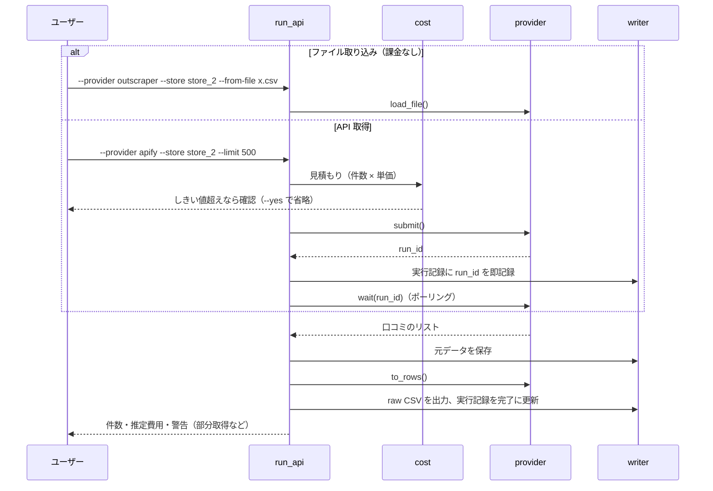

# サードパーティサービス レビュー収集 設計書（改訂版 v1.1）

- 版: v1.1（2026-10-31）／原案 [00_original.md](00_original.md) をレビュー [01_review.md](01_review.md) に基づき改訂
- v1.1 の変更: 無料枠で始める方針に合わせ、**Outscraper（無料枠は CSV ダウンロードのみ）と Apify（無料クレジットで API 可）を比較してから採用を決める**構成に変更。ファイル取り込みを API 取得と同じ扱いにした
- 実装はこの文書と [03_execution_plan.md](03_execution_plan.md) に従う
- 「**要実測**」と書いた値は Phase 1（無料枠での比較）の実データと公式ドキュメントで確定し、この文書を更新する

---

## 1. 目的とスコープ

**目的**: 店舗の口コミを外部サービスで安定的に全件取得し、既存の分析パイプライン（`normalize` → `tag_aspects` → `gold`）にそのまま流す。まずは**無料枠だけ**でデータの質を確かめ、予算はその結果を見て決める。

| スコープ内 | スコープ外（[バックログ](03_execution_plan.md#バックログ)） |
|---|---|
| 無料枠での Outscraper と Apify の比較 | 差分取得（新着のみ）の定常運用 |
| ダウンロードしたファイルの取り込み（課金なし） | 定期実行・クラウド化 |
| 採用したサービスの API 取得（Apify なら無料クレジット内で可） | 3 社目以降のサービス |
| 収集 CLI、コストガード、実行記録、中断からの回収 | 項目別評価の分析への組み込み |
| 既存パイプラインとの互換、ID 移行ツール | |

### 1.1 比較するサービスの無料枠（2026-10-31 時点の公開情報。Phase 0 で公式ページを確認）

| | Outscraper | Apify（`compass/google-maps-reviews-scraper` など） |
|---|---|---|
| 無料枠 | 月 500 件まで | $10 分のクレジット（アカウント作成時に確認。毎月付与かは要確認） |
| 無料枠での取得方法 | **Web 画面から CSV / XLSX をダウンロード**（API は有料の Medium 以上） | API・Web 画面の両方（要確認） |
| 有料時の単価 | 501〜100,000 件: $3 / 1,000 件 | 公式 Actor（無料プランの単価、2026-10-31 に API で確認）: 口コミ $0.60 / 1,000 件、店舗検索 $0.004 / 店舗、起動 $0.00005 / 回 |
| 注意点 | 有料にしないと自動化できない | 無料プランで「1 店舗 10 件まで」などの制限があるという情報あり（未確認） |

### 1.2 店舗の割り当て（2026-10-31 決定）

| 取得元 | 店舗 | 件数の目安 |
|---|---|---|
| Playwright（既存データのまま） | store_1, store_2（つくば研究学園店） | 159 件。人手ラベルもこのデータに付いているので、外部サービスでは取り直さない |
| Outscraper（無料枠の CSV） | store_3 柏西口店（203 件 → 200 件取得）、store_4 上野駅前店、store_5 池袋西口店 | 合計 500 件程度（月の無料枠いっぱい） |
| Apify（$10 のクレジット） | 「口コミ数の多い・少ない × 星の高い・低い」の 4 区分からバランスよく選ぶ店舗 | 店舗検索の結果を見て決める |

サービス間の比較は、Outscraper の 1 店舗（store_4 など）を Apify でも取得して行う（$0.15 程度）。比較用に取った方のデータは `data/raw/` に置かない（§2.2）。

---

## 2. 基本方針

### 2.1 既存資産の保全範囲

| 区分 | 対象 | ルール |
|---|---|---|
| 変更しない | `src/main.py`, `src/scraper.py`, `src/parser.py`, `src/config.py`, `src/logger.py`, `src/pipeline/**` | 1 行も変更しない。import して再利用するのは可 |
| 追記のみ可 | `.gitignore`, `README.md`, `requirements.txt`, `data/master/stores.csv` | 既存の行は変えない。`stores.csv` への列追加は `normalize` が列名指定で読むため互換 |
| 新規 | `src/api/**`, `src/run_api.py`, `tests/**`, `pytest.ini`, `requirements-dev.txt` | この設計に従う |

再利用する既存関数:
- `src.logger.setup_logger`（ログ）
- `src.pipeline.normalize.parse_attributes`（属性文字列 → ローカルガイド・投稿数）
- `src.pipeline.normalize.build`（結合テスト）
- `src.pipeline.paths`（`RAW_DIR`, `MASTER_STORES`, `BASE_DIR` など）

### 2.2 取得経路の使い分け

| | Playwright 版（`src.main`） | ファイル取り込み（`run_api --from-file`） | API 取得（`run_api`） |
|---|---|---|---|
| 費用 | 無料 | サービス側の無料枠・料金に従う。取り込み自体は課金なし | サービスの無料枠・料金に従う |
| 手作業 | ログイン・実行 | Web 画面で取得・ダウンロード | なし |
| 向いている用途 | API で取れない項目の確認 | Outscraper の無料枠、手動での試し取り | 店舗数を増やすとき、定期的な取得 |

**1 店舗につきデータの取得元は 1 つ**にする（ID 体系が違い、混ぜると重複するため。[01_review.md R5](01_review.md#r5-同じ店舗で-playwright-版と-api-版の-csv-が混ざると重複する)）。比較のために同じ店舗を複数サービスで取ったときは、採用しない方のファイルを `data/raw/` に置かない。

### 2.3 実行環境の制約
- Python 3.9（`.venv`）。`X | None` 型表記を使うファイルは先頭に `from __future__ import annotations` を書く。`match` 文は使わない。
- XLSX の読み込みには `openpyxl` が必要（未導入）。**Outscraper からは CSV でダウンロードする**ことにして、依存を増やさない。

---

## 3. データ契約（raw CSV）

この章が外部サービスと既存パイプラインをつなぐ**唯一の約束**です。変更するときは `normalize.py` の挙動を再確認すること。

### 3.1 ファイル

| 項目 | 規則 |
|---|---|
| 置き場所 | `data/raw/`（直下のみ。サブフォルダは `normalize` に読まれない） |
| ファイル名 | `reviews_{store_key}_{YYYYMMDD_HHMMSS}.csv`（例: `reviews_store_2_20261101_093000.csv`） |
| `store_key` | `stores.csv` の `store_key`（`store_N` 形式）。並び順の番号ではない |
| 文字コード | `utf-8-sig`、行番号なし（`index=False`） |
| 作らないもの | `all_reviews_*.csv`（`normalize` の対象外で不要） |

ファイル名が正規表現 `reviews_(store_\d+)_(\d{8}_\d{6})\.csv$` に一致しないと、エラーなしで無視されます。取得元（サービス名・API かファイルか）はファイル名ではなく実行記録（§9）で管理します。

### 3.2 列（この順序で出力）

`scraper.py` の `OUTPUT_COLUMNS` に `source_url` を加えたもの。

| 列 | 形式 | 必須 | 備考 |
|---|---|:-:|---|
| `store_name` | 文字列 | ○ | `stores.csv` の `store_name` |
| `review_id` | 文字列 | ○ | 空だと `review_uid` がハッシュ値になり、重複除去が弱くなる |
| `reviewer_name` | 文字列 | | |
| `reviewer_id` | 文字列 | | |
| `is_local_guide` | `True`/`False` | | 列があると `normalize` は属性文字列から再計算しない（`normalize.py:110`）。サービスから取れなければ `parse_attributes(reviewer_attributes)` で補う |
| `reviewer_review_count` | 整数 | | 同上 |
| `reviewer_attributes` | 文字列 | | 旧形式の `attributes` ではない |
| `rating` | 整数 1〜5 | ○ | |
| `review_text` | 文字列 | | 本文なしは空文字。**原文**を入れる（翻訳文ではない） |
| `post_time` | `YYYY-MM-DD HH:MM:SS`（JST、タイムゾーン表記なし） | ○ | UTC から変換する |
| `updated_time` | 同上 | | 取れなければ空 |
| `relative_time` | 文字列 | 列は必須 | **この列があることで新形式と判定される**（`normalize.py:90`）。値は空でもよい |
| `owner_reply` | 文字列 | | |
| `owner_reply_time` | 日時（JST） | | |
| `source_url` | 文字列 | ○ | `stores.csv` の `url` と**一字一句同じ**値 |

### 3.3 `normalize` の挙動で注意する点

| 挙動 | 該当箇所 | 影響と対策 |
|---|---|---|
| 店舗ごとに最新ファイルだけを使う（既定） | `normalize.py:127-128` | 件数上限付きの取得が最新になると過去分が消える → 全件取得を基本とし、上限が総件数未満なら CLI が警告 |
| `--all-snapshots` で全ファイルを統合し、`review_uid` で重複除去 | `normalize.py:142` | 取得元が違うファイルを混ぜると重複する → 1 店舗 1 取得元 |
| 店舗の特定は `source_url` の完全一致 → ファイル名の `store_N` | `normalize.py:76-85` | どちらかが一致すればよいが、両方そろえる |
| `review_uid` = `review_id`、なければ `h_` + SHA1 | `normalize.py:54-58` | 既存の人手ラベルと LLM キャッシュは `h_` 形式 → §10 で移行 |

---

## 4. サービス別の項目対応（候補・要実測）

以下は公開情報からの**候補**です。Phase 1 の実データで確定し、「確定」列を埋めます。サービス間で `review_id` の形式が同じかどうかも確認します（同じなら、後でサービスを切り替えても重複しない）。

### 4.1 Outscraper（CSV ダウンロード・API 共通の見込み）

| raw CSV の列 | 候補フィールド | 変換 | 確定 |
|---|---|---|:-:|
| `review_id` | `review_id` | 文字列 | |
| `reviewer_name` | `author_title` | 文字列 | |
| `reviewer_id` | `author_id` | 文字列 | |
| `is_local_guide` | 該当なしの見込み → 属性文字列から判定 | `parse_attributes` | |
| `reviewer_review_count` | `author_reviews_count` | 整数 | |
| `rating` | `review_rating` | 整数 | |
| `review_text` | `review_text` | 原文か翻訳かを確認 | |
| `post_time` | `review_timestamp`（UNIX 秒）優先、なければ `review_datetime_utc` | UTC → JST | |
| `owner_reply` | `owner_answer` | 文字列 | |
| `owner_reply_time` | `owner_answer_timestamp` | UTC → JST | |

### 4.2 Apify（`compass/google-maps-reviews-scraper` の場合）

2026-10-31 のテスト取得（上野駅前店 1 件）で、下表のフィールドがすべて存在することを確認した（○）。値の確認は本文ありの口コミで続ける。
- `publishedAtDate` は `2026-10-24T07:39:14.984Z` 形式（UTC）、`publishAt` は「1 週間前」
- `reviewId` は `Ci9DQU…` で始まる 68 文字
- 星だけの口コミは `text` が空
- そのほかに取れる項目: `reviewDetailedRating`（例: 食事・サービス・雰囲気の 1〜5）、`reviewContext`（例: 1 人あたりの料金）、`originalLanguage`、`likesCount`、店舗の `placeId`・`fid`・`totalScore`・`reviewsCount`

| raw CSV の列 | 候補フィールド | 変換 | 確定 |
|---|---|---|:-:|
| `review_id` | `reviewId` | 文字列 | ○ |
| `reviewer_name` | `name` | 文字列 | ○ |
| `reviewer_id` | `reviewerId` | 文字列 | ○ |
| `is_local_guide` | `isLocalGuide` | 真偽値 | ○ |
| `reviewer_review_count` | `reviewerNumberOfReviews` | 整数 | ○ |
| `rating` | `stars` | 整数 | ○ |
| `review_text` | `text`（`textTranslated` は使わない） | 原文 | ○ |
| `post_time` | `publishedAtDate`（ISO 8601、UTC） | UTC → JST | ○ |
| `relative_time` | `publishAt`（「2 か月前」など） | 文字列 | ○ |
| `owner_reply` | `responseFromOwnerText` | 文字列 | ○ |
| `owner_reply_time` | `responseFromOwnerDate` | UTC → JST | ○ |

### 4.3 共通

- `store_name` と `source_url` は `stores.csv` から入れる。
- CSV には出さず、元データにだけ残すもの（将来の分析用）: 項目別評価（Apify は `reviewDetailedRating` が候補）、元の言語（`originalLanguage` が候補）、いいね数、写真 URL、口コミへのリンク、店舗の総口コミ数・平均評価。
- 投稿者名などの個人情報を出力するかどうかは、サービス側の設定で決まる場合がある（Apify は `personalData` などの入力項目が候補）。分析には投稿者名は必須ではないが、重複除去の補助と ID 移行（§10）に使うので取得する。

---

## 5. モジュール構成

```
src/
├── api/                          # 新規
│   ├── __init__.py
│   ├── config.py                 # .env の読み込み、上限値、単価、ポーリング間隔
│   ├── base.py                   # Target（店舗）、ReviewProvider（インターフェース）
│   ├── targets.py                # stores.csv → Target のリスト（--store / --all の解決）
│   ├── writer.py                 # 共通: CSV 出力・元データ保存・実行記録の追記
│   ├── cost.py                   # 見積もり・確認・上限チェック
│   ├── migrate_uid.py            # 旧 h_ ID → 新しい review_id への移行ツール
│   └── providers/
│       ├── __init__.py           # get_provider(name)
│       ├── outscraper.py         # ファイル読み込み・項目変換（API は有料にした場合のみ追加）
│       └── apify.py              # Actor の実行・完了待ち・データ取得・項目変換
└── run_api.py                    # 新規 CLI
tests/
└── api/
    ├── fixtures/                 # 匿名化した 3〜5 件（サービスごと）
    ├── test_mapping.py
    ├── test_normalize_compat.py
    ├── test_cost_guard.py
    └── test_polling.py
pytest.ini                        # pythonpath = .
requirements-dev.txt              # pytest
```

Phase 2 で作るのは、Phase 1 で使う・採用すると決めたサービスの分だけです。

### 5.1 インターフェース（案）

```python
from __future__ import annotations
from dataclasses import dataclass
from datetime import datetime
from typing import Protocol

@dataclass(frozen=True)
class Target:
    store_key: str        # "store_2"
    store_name: str
    url: str              # stores.csv の url（source_url にそのまま使う）
    place_id: str | None  # stores.csv の place_id（追加列）。あればこちらで問い合わせる

class ReviewProvider(Protocol):
    name: str
    supports_api: bool
    def load_file(self, path: str) -> list[dict]: ...
        # ダウンロードしたファイル（CSV / JSON）→ 口コミ 1 件 = 1 dict
    def submit(self, target: Target, limit: int, sort: str, since: datetime | None) -> str: ...
        # API で取得を開始し、実行 ID を返す。自動リトライしない（supports_api の場合のみ）
    def wait(self, run_id: str) -> list[dict]: ...
        # 完了まで待って口コミのリストを返す。ポーリングはリトライする
    def to_rows(self, records: list[dict], target: Target) -> list[dict]: ...
        # §3.2 の列をキーにした dict のリスト。ネットワークを使わない純粋関数
```

ファイルでも API でも、`to_rows()` 以降は同じ処理を通ります。

---

## 6. 処理の流れ



### 6.1 CLI

```bash
python -m src.run_api --provider outscraper --store store_2 --from-file <path.csv>   # 取り込み（課金なし）
python -m src.run_api --provider apify --store store_2 --dry-run                     # 見積もりだけ（API を呼ばない）
python -m src.run_api --provider apify --store store_2 --limit 500                   # 1 店舗
python -m src.run_api --provider apify --all --limit 500                             # stores.csv の全店舗
python -m src.run_api --provider apify --store store_2 --resume <run_id>             # 中断した取得の回収（課金なし）
```

| オプション | 既定値 | 説明 |
|---|---|---|
| `--provider` | （必須） | `outscraper` / `apify` |
| `--store` / `--all` | （どちらか必須） | `store_key` で指定。複数指定可。`--from-file` では 1 店舗のみ |
| `--from-file` | なし | ダウンロードしたファイルから取り込む。保存済みの元データから CSV を作り直すときにも使う |
| `--limit` | `DEFAULT_LIMIT_PER_STORE` | 1 店舗あたりの最大件数 |
| `--sort` | `newest` | `newest` / `relevant` / `highest` / `lowest`（Playwright 版と同じ名前。サービスごとの値への変換は provider 側） |
| `--since` | なし | `YYYY-MM-DD`。この日より新しい口コミだけ（バックログ扱い。使うときは §3.3 に注意） |
| `--dry-run` / `--yes` | off | §7 |

Outscraper のファイルに複数店舗が入っている場合は、`--store` で指定した店舗の行だけを取り込む（店舗を見分ける列は Phase 1 で確認）。

---

## 7. コストガード

3 段階で守ります。

| 段階 | 内容 | 担当 |
|---|---|---|
| 1. サービスの管理画面 | 無料枠の残りを確認する。有料にする場合は月額の利用上限を設定する | ユーザー |
| 2. 設定値 | `src/api/config.py` の上限値。超える実行は拒否 | 実装 |
| 3. 実行時の確認 | 見積もりがしきい値を超えたら確認 | 実装 |

`src/api/config.py` の初期値（無料枠で使う前提。予算を決めたら見直す）:

| 名前 | 初期値 | 意味 |
|---|---|---|
| `DEFAULT_LIMIT_PER_STORE` | 300 | `--limit` を省略したときの件数 |
| `MAX_REVIEWS_PER_RUN` | 500 | 1 回の実行の合計件数の上限。超えたら実行しない（設定を直す必要がある） |
| `CONFIRM_THRESHOLD_USD` | 0 | 見積もりが 0 を超えたら（= 無料と言い切れなければ）確認する |
| `PRICE_PER_1000_REVIEWS_USD` | サービス別。要確認 | 公式の料金表で確定する。未設定なら見積もりは「不明」と表示し、確認を必ず求める |

ルール:
- 見積もり = 店舗ごとの min(`limit`, 総件数) の合計 × 単価。総件数がわからなければ `limit` で計算する（多めに見積もる）。
- `--dry-run` と `--from-file` は外部サービスを一切呼ばない。
- 対話できない環境（パイプ・cron など）でしきい値を超えたら、`--yes` がない限り中止する。
- `limit` が総件数より少ないときは「最新ファイルだけが使われるので、過去分が分析から外れる」と警告する（§3.3）。
- Apify では実行ごとに課金上限（`maxTotalChargeUsd`）を必ず指定する。**指定できる最小値は $0.50**（それ未満は実行開始時にエラーになり、課金されない）。件数の上限（`maxReviews` など）と組み合わせて使う。

---

## 8. 信頼性

| 項目 | 方針 |
|---|---|
| 取得の開始（submit） | **自動リトライしない**（二重課金の防止）。応答がタイムアウトしたら「管理画面で確認してから `--resume`」と案内して終了する |
| ポーリング | `tenacity` で指数バックオフ。対象は接続エラー・429・5xx。全体のタイムアウトは 30 分（設定可） |
| 中断からの回収 | `--resume <run_id>` で結果だけを取りに行く（Apify は実行 ID、Outscraper API はリクエスト ID） |
| 再変換 | `--from-file` で保存済みの元データから CSV を作り直す |
| 複数店舗 | 1 店舗が失敗しても次へ進み、最後に成功・失敗の一覧を出す |
| ログ | `setup_logger("api_collector")` を使う。ファイル名は `scrape_*.log` のまま（`logger.py` は変更しない）なので、最初の行に `[api]` と書く。API キーはログに出さない |

---

## 9. 保存とセキュリティ

| 対象 | 場所 | Git |
|---|---|---|
| raw CSV | `data/raw/reviews_{store_key}_{ts}.csv` | 除外（既存の設定） |
| サービスの元データ（API の応答・ダウンロードしたファイル） | `data/raw_vendor/{provider}/{store_key}_{ts}.{json,csv}` | **除外（Phase 0 で `.gitignore` に追記）** |
| 実行記録 | `data/raw_vendor/manifest.jsonl` | 除外 |
| 移行前のバックアップ | `data/processed/reviews_before_api.parquet`, `data/raw/_archive/` | 除外（既存の設定） |
| API キー | `.env` または `~/.env` の `APIFY_TOKEN`（有料化したら `OUTSCRAPER_API_KEY`）。`tag_aspects` と同じ読み込み順 | 除外（既存の設定） |
| テスト用データ | `tests/api/fixtures/` | 含める。**投稿者名・ID・本文は架空の値に置き換える** |

実行記録（1 行 1 JSON）の項目: `run_id`, `provider`, `method`（api / file）, `store_key`, `params`（limit・sort・since）, `status`（submitted / done / failed）, `review_count`, `estimated_usd`, `vendor_raw_path`, `csv_path`, `started_at`, `finished_at`。

---

## 10. 既存データの移行（review_uid）

**背景**: 現在の `reviews.parquet` の `review_uid` は `h_` 形式で、`gold_sample.csv`（人手ラベル）と LLM キャッシュ（`data/processed/llm_cache/<版>/<モデル>/<review_uid>_<本文ハッシュ>.json`）がこの ID に依存しています。外部サービスのデータに置き換えると ID が `review_id` に変わります。

**ツール**: `python -m src.api.migrate_uid --store store_2 [--dry-run]`

手順（Phase 5 で実施）:
1. 取得の前に `data/processed/reviews.parquet` を `reviews_before_api.parquet` としてコピーする
2. 旧 CSV（`data/raw/reviews_store_2_*.csv`）を `data/raw/_archive/` へ移す
3. 採用したサービスで取得・取り込み → `normalize` を実行
4. 新旧の `reviews.parquet` を、同じ店舗で**本文（前後の空白を除く）が一致するもの**で突き合わせ、旧 ID → 新 ID の対応表を作る。本文が同じものが複数ある場合は投稿者名・星の数でも突き合わせ、それでも決まらなければ「対応不明」とする
5. `gold_sample.csv` の `review_uid` を置き換える（元のファイルは `gold_sample.csv.bak` として残す）
6. LLM キャッシュを新しい ID のファイル名で**コピー**する（元のファイルは残す。本文ハッシュは同じなのでそのまま使える）
7. 対応できなかった件数と ID を表示する

人手ラベルは本文ありの口コミだけが対象なので、本文での突き合わせでほぼ対応が取れる見込みです。

---

## 11. テスト方針

| テスト | 確認すること | ネットワーク |
|---|---|---|
| `test_mapping.py` | サービスごとに、列の集合と順序が §3.2 と一致、JST への変換、星が 1〜5 の整数、本文なしが空文字、翻訳文ではなく原文が入る | 不要 |
| `test_normalize_compat.py` | 一時フォルダに出力した CSV を `normalize.build(raw_dir=一時フォルダ)` に通し、店舗が特定できる・`review_uid == review_id`・`time_is_estimated` が False・日時が JST | 不要 |
| `test_cost_guard.py` | 見積もり、しきい値での確認、上限超過での拒否、部分取得の警告 | 不要 |
| `test_polling.py` | HTTP 呼び出しを差し替え、ポーリングのリトライ・タイムアウト・submit をリトライしないこと | 不要 |

`test_normalize_compat.py` は実物の `data/master/stores.csv` を読み取り専用で使います（`store_2` が存在する前提）。

---

## 12. 未決事項

| ID | 内容 | 現時点の方針 | 決める時期 |
|---|---|---|---|
| D1 | 採用するサービス | 無料枠で Outscraper（CSV）と Apify（API）を比べてから決める。評価項目は [03_execution_plan.md Phase 1](03_execution_plan.md#phase-1-無料枠での比較) | Phase 1 の終わり |
| D2 | 取得の規模 | §1.2 のとおり。Outscraper 3 店舗＋Apify で 4 区分の店舗（クレジットの範囲内） | 決定済み（Apify の店舗は検索結果を見て決める） |
| D3 | 予算 | 無料枠と Apify の $10 クレジットの範囲で行う。クレジットを使う実行は毎回、見積もりを示して承認を得る | Phase 1 の終わりに見直す |
| D4 | Playwright 版の扱い | 予備として残す。外部サービスに切り替えた店舗では使わない | Phase 5 |
| D5 | `stores.csv` への `place_id` 列追加 | 追加する | Phase 0 |
