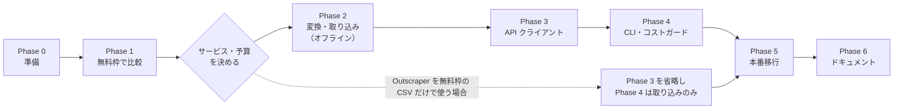

# 実行計画（v1.1）

- 設計: [02_design.md](02_design.md)／レビュー: [01_review.md](01_review.md)
- v1.1 の変更: 無料枠だけで Outscraper と Apify を比較し、予算とサービスはその結果で決める流れに変更
- 担当の凡例: **[U]** ユーザーが行う／**[C]** Claude が行う／**[C→U承認]** Claude が準備し、ユーザーの承認後に実行（外部サービスを使うもの）
- 作業が終わったら、下の進捗表とチェックボックスを更新する

## 進捗

| Phase | 内容 | 費用 | 状態 | 完了日 |
|---|---|---|---|---|
| 0 | 準備（アカウント・無料枠の確認） | なし | 完了（アカウント・トークン済み、`stores.csv` に store_3〜5 と `place_id` 列を追加済み。Phase 0 の作業は完了） | |
| 1 | 無料枠での比較 → サービス・予算の決定 | 無料枠内 | 進行中（Apify: 8 店舗＋比較用 store_4 の口コミ取得済み。残り: Outscraper の CSV、評価表） | |
| 2 | データ契約と変換処理・ファイル取り込み（オフライン） | なし | **完了**（Apify 全9店舗 3,408件を取り込み、`normalize` で全 3,567 件を統合済） | 2026-11-01 |
| 3 | API クライアント（ポーリング・リトライ・回収） | なし | 未着手 | |
| 4 | CLI とコストガード | なし | 未着手 | |
| 5 | 本番移行（store_2 → 全店舗）と ID 移行 | 無料枠内の見込み | 未着手 | |
| 6 | ドキュメント整備 | なし | 未着手 | |

---

## 全フェーズ共通の完了条件

- [ ] 既存コードに差分がない: `git diff --stat -- src/main.py src/scraper.py src/parser.py src/config.py src/logger.py src/pipeline/` の出力が空
- [ ] `pytest` がすべて通る（Phase 2 以降）
- [ ] 個人情報を含むファイルがコミットされていない: `git status --short` に `data/raw`, `data/raw_vendor`, `data/processed`, `data/debug`, `data/logs` のファイルが出ない
- [ ] この文書の進捗表を更新した

---

## Phase 0: 準備

| ID | 担当 | 作業 | 成果物 |
|---|---|---|---|
| P0-1 | [U] | Outscraper の無料アカウントを作成。公式の料金ページで、無料枠の件数・リセット時期・CSV 以外の取得方法がないかを確認 | 無料枠の条件 |
| P0-2 | [U] | Apify の無料アカウントを作成。料金ページで毎月の無料クレジットと、無料プランでの制限（1 店舗あたりの件数など）を確認。API トークンを発行し、プロジェクト直下の `.env` に `APIFY_TOKEN=...` を追記 | `.env`、無料枠の条件 |
| P0-3 | [U] | Apify Store で使う Actor を選ぶ（第一候補は公式の `compass/google-maps-reviews-scraper`）。Actor ページの単価を確認 | Actor 名・単価 |
| P0-4 | [C] | `.gitignore` に `data/raw_vendor/` を追記 | `.gitignore` |
| P0-5 | [C] | `data/master/stores.csv` に空の `place_id` 列を追加し、`python -m src.pipeline.normalize` が従来どおり 159 件を出力することを確認（ローカル処理のみ） | `stores.csv` |
| P0-6 | [C] | P0-1〜P0-3 の結果を [02_design.md §1.1・§7](02_design.md#11-比較するサービスの無料枠2026-10-31-時点の公開情報phase-0-で公式ページを確認) に反映 | 設計書の更新 |

**完了条件**
- [ ] `.env` に `APIFY_TOKEN` がある（Claude は値を読まない。`grep -c APIFY_TOKEN .env` で行数だけ確認）
- [ ] 両サービスの無料枠の条件がわかっている
- [ ] `git check-ignore data/raw_vendor/x.json` が除外を示す
- [ ] `normalize` の件数が変わらない

---

## Phase 1: 無料枠での比較

目的: 店舗の割り当て（[02_design.md §1.2](02_design.md#12-店舗の割り当て2026-10-31-決定)）に沿ってデータを集め、1 店舗は両方のサービスで取って質を比べる。ここで取ったデータは Phase 2 以降の開発（課金なし）にも使う。store_2 は取り直さない。

| ID | 担当 | 作業 | 成果物 |
|---|---|---|---|
| P1-0 | [C→U承認] | Apify の店舗検索（`compass/crawler-google-places`）で赤からの店舗一覧（星・口コミ数）を取り、4 区分の候補を提案 → [U] が店舗を決め、`stores.csv` に追加 | 候補一覧 |
| P1-1 | [U] | Outscraper の Web 画面で store_3〜5 の口コミを取得し、**CSV で**ダウンロード（言語は日本語、合計 500 件以内）。`data/raw_vendor/outscraper/` に置く | Outscraper の CSV |
| P1-2 | [C] | `src/api/config.py`（トークン読み込み）と `src/api/providers/apify.py` の `submit()` / `wait()` の最小版を作る。結果はそのまま `data/raw_vendor/apify/` に保存 | 最小のクライアント |
| P1-3 | [C→U承認] | Apify で比較用に store_4 を取得（新しい順、日本語、課金上限を指定）。無料プランの制限で件数が足りなければ、その事実を記録する | Apify の JSON |
| P1-4 | [C] | 両方のデータを、下の評価表で比べて記入し、[02_design.md §4](02_design.md#4-サービス別の項目対応候補要実測) の「確定」列を更新 | 評価表・設計書の更新 |
| P1-5 | [C] | 各サービスのデータから 3〜5 件を抜き出し、投稿者名・ID・本文を架空の値に置き換えて `tests/api/fixtures/` に置く（本文なし・オーナー返信あり・星 1 と星 5 を含める） | テスト用データ |
| P1-6 | [U] | 両サービスの管理画面で、無料枠の消費量（課金が発生していないこと）を確認 | 消費量 |
| P1-7 | [U] | 評価表を見て D1（サービス）・D2（規模）・D3（予算）を決める | 決定 |

**P1-0 の結果（2026-10-31）**
- テスト: 店舗情報 1 件（$0.0052）、口コミ 1 件（$0.00005）とも成功。Apify の課金上限は最小 $0.50
- 店舗一覧: 30 都道府県を検索し、赤から 113 店舗（星のある 110 店舗で、星の中央値 3.7、口コミ数の中央値 124）。$0.48。一覧は `data/master/akakara_places_20261031.csv`
- Outscraper の 3 店舗の位置: 柏西口 4.5 / 203 件（多・高）、上野駅前 3.1 / 139 件（中・低）、池袋西口 3.4 / 159 件（中・低）
- 星の低い店舗は口コミが少ない傾向があり、「多・低」は口コミ 200 件前後が上限

Apify の候補（各区分 2 店舗。区分の目安: 多 = 150 件以上、少 = 90 件以下、高 = 星 4.0 以上、低 = 星 3.4 以下）

| 区分 | 店舗 | 星 | 口コミ数 |
|---|---|---|---|
| 多・高 | 北千住店（東京） | 4.5 | 1,235 |
| 多・高 | 獨協大学前駅東口店（埼玉） | 4.8 | 1,377 |
| 多・低 | 新宿東口店（東京） | 3.2 | 179 |
| 多・低 | 京都伏見店（京都） | 3.1 | 200 |
| 少・高 | 新潟万代シティ店（新潟） | 4.2 | 70 |
| 少・高 | 福岡東店（福岡） | 4.2 | 88 |
| 少・低 | 高崎問屋町店（群馬） | 3.3 | 62 |
| 少・低 | 太田川店（愛知） | 3.2 | 59 |

全件取得の見積もり: 8 店舗で約 3,270 件 ≈ $2.0（$0.60 / 1,000 件）＋比較用の上野駅前店 139 件 ≈ $0.08。

**P1-3 の結果（2026-10-31）**: 8 店舗を store_6〜13 として `stores.csv` に登録し、比較用の store_4 と合わせて Apify で全件取得した。

| store | 店舗 | 件数 | 本文あり | 日本語以外 | 返信あり | 項目別評価 | ローカルガイド | 期間 |
|---|---|---|---|---|---|---|---|---|
| store_4 | 上野駅前 | 138 | 59% | 7 | 0% | 43% | 72% | 2018-12〜 |
| store_6 | 北千住 | 1,235 | 55% | 4 | 10% | 91% | 7% | 2016-10〜 |
| store_7 | 獨協大学前駅東口 | 1,378 | 38% | 5 | 96% | 86% | 5% | 2018-09〜 |
| store_8 | 新宿東口 | 179 | 61% | 14 | 4% | 36% | 70% | 2016-12〜 |
| store_9 | 京都伏見 | 200 | 48% | 1 | 0% | 20% | 79% | 2016-07〜 |
| store_10 | 新潟万代シティ | 70 | 71% | 0 | 99% | 91% | 7% | 2026-02〜 |
| store_11 | 福岡東 | 87 | 47% | 1 | 100% | 79% | 64% | 2023-02〜 |
| store_12 | 高崎問屋町 | 62 | 53% | 0 | 98% | 50% | 61% | 2020-06〜 |
| store_13 | 太田川 | 59 | 54% | 0 | 32% | 14% | 75% | 2017-01〜 |

- 合計 3,408 件。件数は Google マップの表示とほぼ一致、`reviewId` の重複なし、投稿日時は全件あり
- 日本語以外の口コミは `text` が原文、`textTranslated` に翻訳が入る（インバウンド分析に使える）
- 費用: 実行記録の集計で $1.72（課金イベント 3,207 件 × $0.0006 ≈ $1.92 が上限の目安）。確定値は管理画面で確認
- 気づき: 口コミが多く星が高い店舗（北千住・獨協）と新潟は、ローカルガイドの割合が低く（5〜7%）項目別評価の割合が高い（約 90%）。店頭での投稿依頼など、投稿のされ方が他店と違う可能性があり、分析時に考慮が必要

**評価表**（P1-4。比較対象は両方で取った store_4、基準は Google マップ上の総件数）

| 評価項目 | Outscraper（CSV） | Apify（API） |
|---|---|---|
| 取得件数 / Google マップ上の総件数 | | |
| 本文の欠け・途中切れ | | |
| 本文が原文か（翻訳文が混ざらないか）・言語コードの有無 | | |
| 投稿日時の精度（日時か、「〜か月前」だけか） | | |
| オーナー返信と返信日時 | | |
| ローカルガイド・投稿者の口コミ数 | | |
| 項目別評価（料理・サービス・雰囲気など） | | |
| `review_id` の形式（両サービスで同じか） | | |
| 短縮 URL で指定できたか／Place ID が必要か | | |
| 所要時間・手作業の量 | | |
| 無料枠で続けられる規模（月あたり件数） | | |
| 有料にした場合の 1,000 件あたりの費用 | | |
| `store_1`（店名要確認）の正式な店名 | | |

**判断の目安**
- 質が同等なら、自動化できる方（API が無料枠でも使える方）を選ぶ
- 無料枠の Outscraper CSV で十分なら、Phase 3（API クライアント）を省略し、ファイル取り込みだけで運用できる
- どちらも基準（本文・星・投稿日時・`review_id` が取れ、件数が Google マップの表示と大きく違わない）を満たさなければ、SerpApi などで同じ比較を行う

---

## Phase 2: データ契約と変換処理・ファイル取り込み（オフライン・課金なし）

Phase 1 で使ったサービスの分を作ります（採用しなかったサービスの変換処理は、比較のために作ったものがあれば残してよい）。

| ID | 担当 | 作業 | 成果物 |
|---|---|---|---|
| P2-1 | [C] | `pytest.ini`（`pythonpath = .`、`testpaths = tests`）と `requirements-dev.txt`（`pytest`）を作り、`.venv` に pytest を入れる | テスト環境 |
| P2-2 | [C] | `src/api/base.py`（`Target`, `ReviewProvider`） | |
| P2-3 | [C] | `src/api/targets.py`（`stores.csv` → `Target`、`--store`/`--all` の解決、存在しない `store_key` はエラー） | |
| P2-4 | [C] | 各 provider の `load_file()` と `to_rows()`（§4 の確定版に従う。JST 変換、原文の採用、`parse_attributes` による補完） | |
| P2-5 | [C] | `src/api/writer.py`（§3 の列順で CSV 出力、元データ保存、実行記録の追記・更新） | |
| P2-6 | [C] | `test_mapping.py`, `test_normalize_compat.py` | テスト |

**完了条件**
- [x] `pytest` が通る（40 件パス）
- [x] 結合テストで、`normalize.build()` が店舗を特定でき、`review_uid == review_id`、`time_is_estimated` がすべて False、`post_time` がテスト用データの UTC 時刻 + 9 時間になっている

---

## Phase 3: API クライアント（ポーリング・リトライ・回収）

採用したサービスを API で使う場合だけ行います（Outscraper を無料枠の CSV だけで使うなら省略）。

| ID | 担当 | 作業 |
|---|---|---|
| P3-1 | [C] | `submit()`: 自動リトライなし。実行 ID を受け取ったらすぐ実行記録に `submitted` で書く |
| P3-2 | [C] | `wait()`: `tenacity` で指数バックオフ（接続エラー・429・5xx）、全体のタイムアウト、完了したら口コミのリストを返す |
| P3-3 | [C] | `--resume` 用に、実行 ID から結果だけを取得する関数 |
| P3-4 | [C] | `test_polling.py`（HTTP 呼び出しを差し替えて確認） |

**完了条件**
- [ ] `pytest` が通る
- [ ] submit が失敗・タイムアウトしたときに再送されないことをテストで確認
- [ ] API キーがログ・例外メッセージに出ないことを確認

---

## Phase 4: CLI とコストガード

| ID | 担当 | 作業 |
|---|---|---|
| P4-1 | [C] | `src/api/cost.py`（見積もり、しきい値での確認、上限での拒否、部分取得の警告）。API を使わない場合は部分取得の警告だけ |
| P4-2 | [C] | `src/run_api.py`（[02_design.md §6.1](02_design.md#61-cli) のオプション一式、店舗ごとの成功・失敗の一覧） |
| P4-3 | [C] | `test_cost_guard.py` |
| P4-4 | [C] | Phase 1 のデータに `--from-file` を使って raw CSV を作り、一時フォルダで `normalize` を通して件数と内容を確認（課金なし） |

**完了条件**
- [ ] `--dry-run` と `--from-file` で外部サービスが呼ばれない（テストで確認）
- [ ] しきい値超えで確認が出る／対話できない環境では中止する
- [ ] `MAX_REVIEWS_PER_RUN` を超える指定は拒否する
- [ ] `--from-file` で作った CSV が `normalize` に通る

---

## Phase 5: 本番移行（store_2 → 全店舗）と ID 移行

| ID | 担当 | 作業 |
|---|---|---|
| P5-1 | [C] | バックアップ: `reviews.parquet` → `reviews_before_api.parquet` |
| P5-2 | [C] | Phase 1 のデータを `--from-file` で store_3〜5 と Apify の店舗の raw CSV にする（再取得しない）。足りない店舗があれば [C→U承認] で取得 |
| P5-3 | [C] | `normalize` を実行し、店舗ごとの件数を Google マップ上の総件数と比べる。store_1・2 の件数と `review_uid` が変わっていないことも確認 |
| P5-4 | [C→U承認] | `tag_aspects` を実行（キャッシュにない件数と見積もりを先に伝えて承認を得る）→ `gold evaluate` で移行前と同じ評価件数が出ることを確認 |
| P5-5 | [U] | D4（Playwright 版の扱い）を確定 |

store_2 は取り直さないので、ID 移行（`migrate_uid.py`、[02_design.md §10](02_design.md#10-既存データの移行review_uid)）は不要になった。store_1・2 を外部サービスで取り直すことにした場合だけ作る（バックログ）。

**完了条件**
- [ ] `reviews.parquet` に新しい店舗が入り、重複がない。store_1・2 は変わっていない
- [ ] `gold evaluate` の対象件数が移行前と同じ（対応不明があれば理由を記録）
- [ ] 無料枠を超えていない（超える場合は事前に承認を得ている）

---

## Phase 6: ドキュメント整備

| ID | 担当 | 作業 |
|---|---|---|
| P6-1 | [C] | `README.md` に外部サービス版の節（セットアップ・コマンド・無料枠と費用の注意）と、Playwright 版との使い分けを追記 |
| P6-2 | [C] | `CLAUDE.md` の「予定」と書いたコマンドを確定版に直し、既知の仕様を更新 |
| P6-3 | [C] | この文書の進捗表を「完了」にし、バックログを見直す |

---

## バックログ

| 項目 | 前提・注意 |
|---|---|
| 差分取得（`--since`）の定常運用 | `normalize --all-snapshots` との組み合わせ手順を決めてから（[01_review.md R3](01_review.md#r3-店舗ごとに最新ファイルだけを使うルールと件数上限差分取得がぶつかる原案-6-2-6-3)） |
| 店舗の追加 | analysis_proposal フェーズ 4（寄与度モデル）に必要な店舗数を決める。無料枠を超えるなら D3 を見直す |
| 項目別評価と LLM 観点の一致度の検証 | Phase 1 で項目別評価が取れると確認できた場合 |
| 定期実行 | 差分取得が安定してから |
| ID 移行ツール（`migrate_uid.py`） | store_1・2 を外部サービスで取り直す場合のみ |
| 3 社目のサービス（SerpApi など） | Phase 1 で両方とも基準を満たさない場合、または料金・仕様の変更で必要になったとき |

---

## セッションの分け方（トークン節約）

1 フェーズ 1 セッションを目安にします。新しいセッションでは、最初に `CLAUDE.md` とこの文書の該当フェーズだけを読みます。

| Phase | 最初に読むもの | 読まなくてよいもの |
|---|---|---|
| 0 | この文書の Phase 0、`.gitignore`、`data/master/stores.csv` | `src/` 全般 |
| 1 | Phase 1、[02_design.md §1.1・§4・§8](02_design.md#4-サービス別の項目対応候補要実測) | `src/scraper.py`, `src/pipeline/` |
| 2 | Phase 2、[02_design.md §3・§5](02_design.md#3-データ契約raw-csv)、`src/pipeline/normalize.py` | `src/scraper.py`（列は §3.2 に記載済み） |
| 3 | Phase 3、[02_design.md §8](02_design.md#8-信頼性)、`src/api/providers/` の該当ファイル | `src/pipeline/` |
| 4 | Phase 4、[02_design.md §6・§7](02_design.md#6-処理の流れ)、`src/api/` | `src/pipeline/` |
| 5 | Phase 5、[02_design.md §10](02_design.md#10-既存データの移行review_uid)、`src/pipeline/gold.py`、`tag_aspects.py` の 60〜110 行 | `src/scraper.py` |
| 6 | Phase 6、`README.md`、`CLAUDE.md` | `src/` 全般 |

すべてのフェーズで、原案（[00_original.md](00_original.md)）と全体レビュー（[01_review.md](01_review.md)）は読まなくて構いません。判断の理由を確かめたいときだけ該当の項目を読みます。
